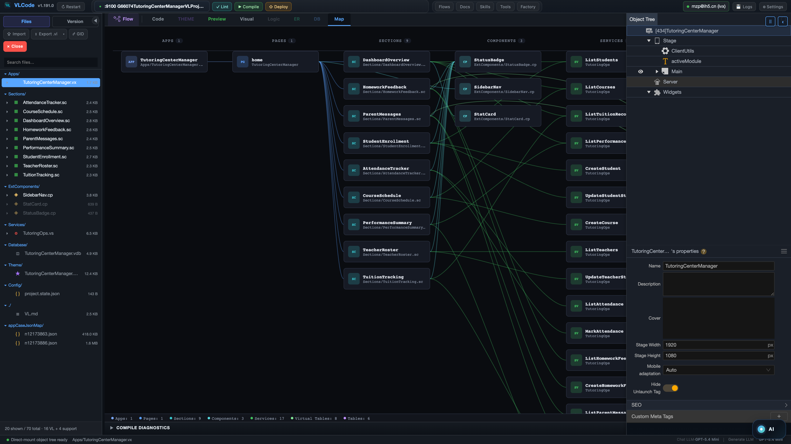

# VisualLogic / VLCode

**The VisualLogic Agent OS: AI-native software development for enterprise applications and agentic workflows.**

VisualLogic is an Agent OS: one unified base, two application forms — deterministic VL apps and always-ready `.vflow` flow apps — and the workbenches to build, run, and govern them. VLCode (the Build workbench) and VL Agent (the Flow workbench) share a Visual Language (VL), a DAG workflow engine, and a reusable AI asset layer; VL Matrix (the Team workbench) is where AI teams execute. Together they turn intent into complete applications, always-ready flows, and reusable enterprise intelligence.

> Source code is commercial and private. This public repository is for product positioning, public documentation, demo media, decks, and installer links.

## What We Are Sharing Publicly

- **Enterprise AI Assets**: own reusable intelligence instead of renting one-off token output.
- **AI harness by DAG**: creativity inside nodes, determinism in the edges, every run inspectable.
- **VL, a programming language designed for AI**: a compact representation for UI, logic, backend, data, theme, and deployment.
- **Visual programming for real systems**: Map, DAG, ER, code, preview, and detail logs are projections of the same underlying system.
- **Installers and tutorials**: public desktop installers for macOS and Windows, plus English usage guides.

## Download VLCode

Current public desktop builds are hosted in the dedicated release repository:

| Platform | Latest Public Build | Download |
|---|---:|---|
| macOS Apple Silicon | `v1.230.1` | [DMG](https://github.com/VisualLogic-AI/vlcode-releases/releases/download/v1.230.1/VLCode-Lite-1.230.1-arm64.dmg) · [ZIP](https://github.com/VisualLogic-AI/vlcode-releases/releases/download/v1.230.1/VLCode-Lite-1.230.1-arm64.zip) |
| Windows x64 | `v1.230.0` | [EXE installer](https://github.com/VisualLogic-AI/vlcode-releases/releases/download/v1.230.0/VLCode-Lite-1.230.0-x64.exe) |

See [Install And Use VLCode](docs/INSTALL_AND_USE.md) for setup, first-run workflow, validation, and troubleshooting.

## Core Materials

| Topic | Materials |
|---|---|
| Enterprise AI Assets | [Concept article](docs/concepts/Enterprise-AI-Assets.md) · [PDF](decks/VL-Enterprise-AI-Assets-EN.pdf) · [PPTX](decks/VL-Enterprise-AI-Assets-EN.pptx) |
| VLCode product | [PDF](decks/VLCode-Core-EN.pdf) · [PPTX](decks/VLCode-Core-EN.pptx) · [Tutorial PDF](docs/tutorials/VLCode-Tutorial-EN.pdf) |
| VL Agent product | [PDF](decks/VL-Agent-Core-EN.pdf) · [PPTX](decks/VL-Agent-Core-EN.pptx) · [Tutorial PDF](docs/tutorials/VL-Agent-Tutorial-EN.pdf) |
| DAG harness thesis | [Video](media/VisualLogic-DAG-Harness-Video.mp4) · [PDF](decks/VisualLogic-DAG-Harness-Video.pdf) · [PPTX](decks/VisualLogic-DAG-Harness-Video.pptx) |
| Product demo | [English intro video](media/VLC-English-Intro.mp4) · [Screenshot gallery](docs/SCREENSHOTS.md) |

## Matrix Product Videos

Download the videos as release assets, no login required: [batch 2 (v5 English, Chinese v2, English intro)](https://github.com/VisualLogic-AI/VL-Code-Introduction/releases/tag/matrix-product-videos-20261109) · [batch 1 (v1 to v4)](https://github.com/VisualLogic-AI/VL-Code-Introduction/releases/tag/matrix-product-videos-20261108).

| Version | Language | Duration |
|---|---|---:|
| [v5 — latest English introduction](https://github.com/VisualLogic-AI/VL-Code-Introduction/releases/download/matrix-product-videos-20261109/Matrix-Intro-EN-v5.mp4): DAG views, live tool-DAG run, VLC tour, hosted Huzhou VL apps (narration at 1.3×) | English | 6:38 |
| [Chinese v2 (TTS route, 1.45× narration)](https://github.com/VisualLogic-AI/VL-Code-Introduction/releases/download/matrix-product-videos-20261109/Matrix-Intro-ZH-v2-tts.mp4) · [English intro](https://github.com/VisualLogic-AI/VL-Code-Introduction/releases/download/matrix-product-videos-20261109/Matrix-Product-Intro-EN-tts.mp4) — made on the Mac with real desktop captures; subtitles, timelines and QA reports alongside | Chinese / English | 4:48 / 4:49 |
| v4 — latest Chinese introduction, including the Huzhou project demonstration | Chinese | 9:11 |
| v3 — previous Chinese introduction | Chinese | 7:55 |
| v2 — extended product tour | English | 9:47 |
| v1 — introductory sample | English | 3:41 |

All raw recordings, slides, narration script and the recording/compose pipeline behind v5 are in [`media/matrix-video/`](media/matrix-video/README.md); the Mac-side production kit (narration scripts, TTS/capture/render/build scripts, product screenshots, readiness and QA probes) is in [`media/matrix-video/mac-session/`](media/matrix-video/mac-session/README.md). Team members can reuse both to produce new cuts. The release includes SHA-256 checksums and exact file metadata. Videos preserve their recorded state, including labeled prototypes and simulations; they are not production acceptance certificates.

## The Short Version

**AI is brilliant at a point. It cannot hold a line.** A DAG is the bridge from point intelligence to process intelligence: each node can use the right model or tool, while the edges preserve dependency, validation, review, and replay.

**VL is the representation layer.** Instead of forcing AI to manipulate large implicit codebases, VisualLogic gives AI a compact, structured language for full-stack application systems. VL acts as an intermediate representation: human intent -> VL -> executable application.

**An enterprise AI asset is a `.vflow`.** It bundles workflow JSON, subflows, prompts, docs, manifests, and checksums into a portable, inspectable unit. It can be maintained visually, reviewed, reused, installed, paused, resumed, and audited. The platform now supports running a `.vflow` as an always-ready application: install it once and it stays armed, and a trigger — a click, a webhook, a schedule, a data change — collapses it into a fully logged run.

## Repository Boundary

This repository intentionally does **not** contain:

- VLCode product source code
- VL parser/compiler implementation
- private workflow source, platform secrets, or internal infrastructure
- customer projects or proprietary generated applications

For public downloads, use [VisualLogic-AI/vlcode-releases](https://github.com/VisualLogic-AI/vlcode-releases). For the product website, visit [visuallogic.ai](https://www.visuallogic.ai/).
